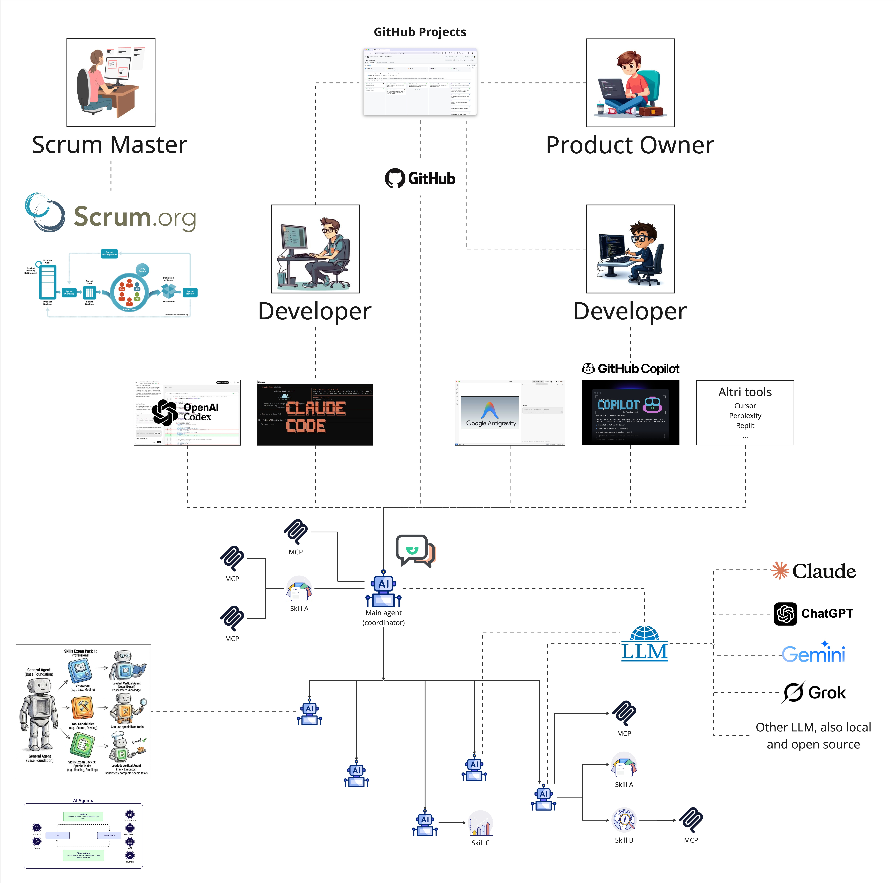

# Vibe Coding — Environment Setup Guide

This guide walks through setting up a working environment for Vibe Coding on this repository (or any repository derived from it). It applies to any AI coding assistant used via CLI (Claude Code, OpenAI Codex, Google Antigravity, OpenCode, GitHub Copilot CLI, Gemini CLI, etc.), with Claude Code + the Superpowers plugin as the reference setup.




---

## Setup checklist

1. [ ] Install prerequisites (`git`, `gh`, an AI coding CLI)
2. [ ] Install the mandatory Superpowers plugin
3. [ ] Install project agents into `.claude/agents/` or equivalent
4. [ ] Install project skills into `.agents/skills/`
5. [ ] Verify MCP servers in `.mcp.json`
6. [ ] Set up the AI instructions file for this repo (`AGENTS.md`), starting from `vibe/AGENTS.template.md`

---

## 1. Install prerequisites

- `git` and `gh` (for PRs)
- One AI coding CLI, configured per the table below
- Optional: [`markitdown`](https://github.com/microsoft/markitdown) (`pip install 'markitdown[all]'`), to ingest `.docx`, `.pptx`, `.xlsx` and other binary files into the second brain (see `docs/second-brain/SCHEMA.md`)
- Optional: [`uv`](https://docs.astral.sh/uv/), if the project has Python code (e.g. e2e tests in `sources/tests/e2e/`) — run it through `uv run …` rather than invoking `python`/`pip` directly

| Tool | Config dir | Instructions file | Skills |
|---|---|---|---|
| Claude Code | `.claude/` | `CLAUDE.md` (→ `@AGENTS.md`) | `.claude/skills/` (symlink to `.agents/skills/`) |
| OpenAI Codex | `.codex/` | `AGENTS.md` | `.agents/skills/` |
| Google Antigravity (`agy`) | `.agents/` | `AGENTS.md` | `.agents/skills/` |
| OpenCode | `.opencode/` | `AGENTS.md` | `.agents/skills/` |
| GitHub Copilot | `.github/` | `AGENTS.md` or `COPILOT-INSTRUCTIONS.md` | own folder — check its docs |
| Gemini CLI | `.gemini/` | `GEMINI.md` (→ `@AGENTS.md`) | own folder — check its docs |

Each tool reads its own instructions file at startup. Keep one canonical file — `AGENTS.md` at the repo root, next to `README.md` — and make every other instructions file a one-line import of it (`CLAUDE.md` and `GEMINI.md` in this repo contain just `@AGENTS.md`), instead of duplicating content.

Keep `AGENTS.md` short: it is loaded on every interaction. Rules needed only for specific work go in files read on demand — in this repo the second-brain rules live in `docs/second-brain/SCHEMA.md` and are read by the `wiki-*` skills.

---

## 2. Install the mandatory Superpowers plugin

Install the Superpowers plugin (multi-platform): https://github.com/obra/superpowers

On Claude Code it is enabled per-repo via `.claude/settings.json` (already done in this repo):

```json
{
  "enabledPlugins": {
    "superpowers@claude-plugins-official": true
  }
}
```

To enable it on a new repo: `claude plugin install superpowers@claude-plugins-official --scope project`. Other CLIs need their own port of Superpowers, installed separately.

Superpowers provides the workflow this project standardizes on for any non-trivial change (SDD + TDD):

1. `brainstorming` — refine the idea before writing code
2. `using-git-worktrees` — isolate the work on its own branch/worktree
3. `writing-plans` — break the work into small, verifiable tasks
4. `subagent-driven-development` or `executing-plans` — implement task by task
5. `test-driven-development` — red/green/refactor per task
6. `requesting-code-review` — review against the plan before moving on
7. `finishing-a-development-branch` — merge/PR/cleanup

Use this sequence as the default for features and bug fixes; skip steps only for genuinely trivial changes.

---

## 3. Install project agents

Claude Code agents go in `.claude/agents/` (or the equivalent config dir from the table in step 1). None are installed in this repo yet; the reviewers used by the [quality review process](#quality-review-process) are:

```bash
mkdir -p .claude/agents
curl -sL https://raw.githubusercontent.com/VoltAgent/awesome-claude-code-subagents/refs/heads/main/categories/04-quality-security/architect-reviewer.md -o .claude/agents/architect-reviewer.md
curl -sL https://raw.githubusercontent.com/VoltAgent/awesome-claude-code-subagents/refs/heads/main/categories/04-quality-security/code-reviewer.md -o .claude/agents/code-reviewer.md
curl -sL https://raw.githubusercontent.com/VoltAgent/awesome-claude-code-subagents/refs/heads/main/categories/04-quality-security/ui-ux-tester.md -o .claude/agents/ui-ux-tester.md
```

Do not install the [VoltAgent subagents marketplace](https://github.com/VoltAgent/awesome-claude-code-subagents/tree/main/categories) as a whole — copy only the agent definitions actually needed into the repository.

For other CLIs, equivalent agent definitions go in the tool-specific config directory listed in the table in step 1.

---

## 4. Install project skills

Project skills go in `.agents/skills/<name>/SKILL.md`, the [Agent Skills](https://agentskills.io) folder read by Codex, Antigravity and OpenCode. Claude Code reads the same files through the `.claude/skills` symlink, so each skill is written once.

Installed in this repo:

- `wiki-ingest`, `wiki-query`, `wiki-health`, `wiki-lint` — maintain and query the second brain in `docs/second-brain/`

Recommended:

- `webapp-testing` → https://github.com/anthropics/skills/tree/main/skills/webapp-testing (Playwright-based frontend verification)

For Copilot and Gemini CLI, which use their own folders, see the table in step 1.

---

## 5. Verify MCP servers

MCP servers are configured in `.mcp.json` at the repo root. This repo has none yet; create the file when the first one is needed:

```json
{
  "mcpServers": {
  }
}
```

To find more MCP servers: https://registry.modelcontextprotocol.io/ or https://mcpservers.com/. Add new entries under `mcpServers` following the same shape.

GitHub, Supabase, Mail, Calendar, Google Drive and others may be useful for your project.

---

## 6. Setup of the AI instructions file for this repo

`AGENTS.md` at the repo root is the canonical instructions file — every AI coding CLI reads it, either directly or through a one-line import (see step 1). It must include:

- **A pointer to `README.md`** — so the project overview isn't duplicated across instruction files.
- **Layout** — where code (`sources/`, see `sources/README.md`) and knowledge (`docs/second-brain/`) live.
- **Commands** — how to run dev/build/lint/clean for the app, and how to run the test suite.
- **Stack** — a one-line summary of the tech stack, so the assistant doesn't have to infer it from the manifests.
- **The second brain** — how to use the wiki as knowledge, and where its maintenance rules are.

Start from [`AGENTS.template.md`](AGENTS.template.md) in this folder: copy it to the repo root as `AGENTS.md`, fill in the `<placeholders>` for **Commands** and **Stack**, and keep its other sections — *Layout*, *Using the second brain*, *Tasks as checkboxes* and *Commit AI-tooling folders to Git* — verbatim: they are project-independent conventions, not examples to adapt.

NOTE:
- 27/Jun/2026: The *Tasks as checkboxes* convention still does not work reliably. Sometimes the assistant forgets to tick the boxes.

---

## Quality review process

Run quality reviews using the three agents installed in step 3, saving each to `docs/reviews/<YYYY-MM-DD>-<agent-name>.md`:

- `code-reviewer` agent → `docs/reviews/<YYYY-MM-DD>-code-reviewer.md`
- `architect-reviewer` agent → `docs/reviews/<YYYY-MM-DD>-architect-reviewer.md`
- `ui-ux-tester` agent → `docs/reviews/<YYYY-MM-DD>-ui-ux-tester.md`

Spawn each as a subagent rather than running the review inline.

---

## Resources

- Superpowers plugin: https://github.com/obra/superpowers
- VoltAgent subagents marketplace: https://github.com/VoltAgent/awesome-claude-code-subagents/tree/main/categories (copy individual agents only, don't install as a whole)
- Awesome Claude (menu/extensions): https://awesomeclaude.ai
- Anthropic official skills: https://github.com/anthropics/skills
- Agent Skills standard: https://agentskills.io
- MCP server registries: https://registry.modelcontextprotocol.io/, https://mcpservers.com/

## To be evaluated

- claude-plugins-official: frontend-design, code-review, code-simplifier
- https://github.com/thedotmack/claude-mem
- https://context7.com/ - Get the latest docs into Claude, Codex, Cursor, and other agents
