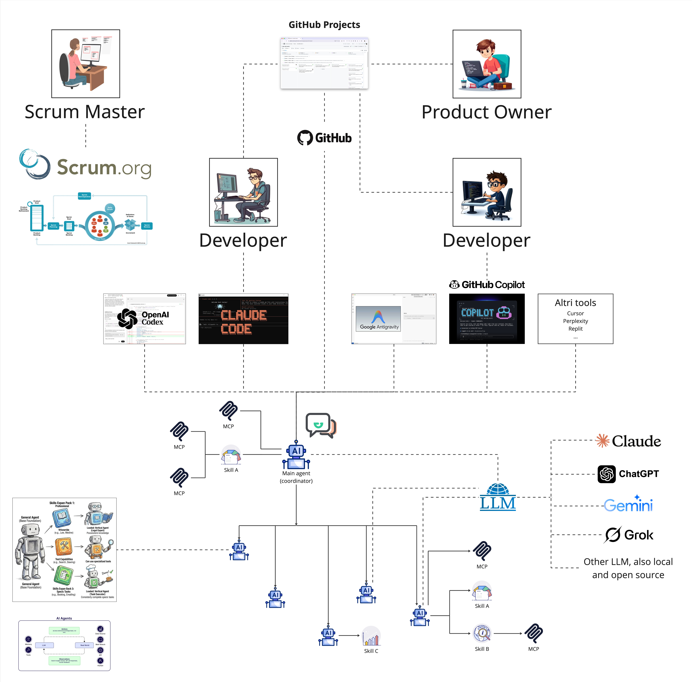

# Vibe Coding — Environment Setup Guide

This guide walks through setting up a development environment for vibe coding, where an AI coding CLI writes most of the code inside rules and knowledge that live in the repository. It applies to any project started from this template and to any AI coding CLI (Claude Code, OpenAI Codex, Google Antigravity, OpenCode, GitHub Copilot CLI, Gemini CLI, …), with Claude Code and the Superpowers plugin as the reference setup; where the other CLIs differ, the guide says so.

How the project's knowledge base is used is described in [second-brain.md](second-brain.md). Once the environment is set up, the [tutorial](https://github.com/frontiere-technologies/vibe/tree/development/vibe/tutorial) in the template repository shows it at work, hands-on.



---

## The four parts of the environment

The agent is free to write code, within four boundaries. Each one has a fixed place in the repository:

| Part | What it holds | Where it lives |
|---|---|---|
| **Knowledge** | What the project is about: domain, decisions, source documents | `docs/second-brain/` — a wiki the agent writes and keeps up to date |
| **Rules** | Stack, commands, layout, conventions, approved libraries, test policy, boundaries | `AGENTS.md` — read by the agent on every interaction |
| **Workflow** | How a change is made: design, plan, isolated branch, test-first build, review, finish | The Superpowers plugin (recommended), or another harness of the project's choice; Superpowers saves specs and plans in `docs/superpowers/`, which it creates |
| **Tools** | Specialised abilities: skills, subagents (reviewers), MCP servers | `.agents/skills/`, `.agents/agents/`, the MCP configuration |

All of it is committed to Git: the environment is part of the project, not of one developer's machine, so every developer and every CLI works the same way. Only personal settings and secrets stay out (see [Shared and personal files](#shared-and-personal-files)).

---

## Setup checklist

0. [ ] Install the prerequisites: `git`, `gh`, an AI coding CLI
1. [ ] Bootstrap the repository from this template
2. [ ] Install the Superpowers workflow plugin (recommended)
3. [ ] Fill in the instructions file (`AGENTS.md`)
4. [ ] Verify the setup

---

## 0. Install the prerequisites

This step installs the tools every developer needs:

- `git`, and `gh` (the GitHub CLI) for pull requests, logged in with `gh auth login`
- at least one AI coding CLI, installed from its official page and logged in:

| CLI | Install and docs | Config dir | Instructions file | Skills | Agents (subagents) | MCP servers |
|---|---|---|---|---|---|---|
| Claude Code | [claude.ai/code](https://claude.ai/code) | `.claude/` | `CLAUDE.md` (→ `@AGENTS.md`) | `.claude/skills/` (symlink to `.agents/skills/`) | `.claude/agents/` (symlink to `.agents/agents/`) | `.mcp.json` |
| OpenAI Codex | [github.com/openai/codex](https://github.com/openai/codex) | `.codex/` | `AGENTS.md` | `.agents/skills/` | `.codex/agents/<name>.toml` (TOML: `name`, `description`, `developer_instructions`), converted from `.agents/agents/` | `config.toml`, `[mcp_servers]` tables |
| Google Antigravity (`agy`) | [antigravity.google](https://antigravity.google) | `.agents/` | `AGENTS.md` | `.agents/skills/` | check its docs | check its docs |
| OpenCode | [opencode.ai](https://opencode.ai) | `.opencode/` | `AGENTS.md` | `.agents/skills/` | `.opencode/agents/` (symlink to `.agents/agents/`; needs `mode: subagent`) | `opencode.json`, `mcp` key |
| GitHub Copilot CLI | [github.com/github/copilot-cli](https://github.com/github/copilot-cli) | `.github/` | `AGENTS.md` or `COPILOT-INSTRUCTIONS.md` | own folder — check its docs | `.github/agents/<name>.agent.md` — check its docs | check its docs |
| Gemini CLI | [github.com/google-gemini/gemini-cli](https://github.com/google-gemini/gemini-cli) | `.gemini/` | `GEMINI.md` (→ `@AGENTS.md`) | own folder — check its docs | `.gemini/agents/<name>.md` (Markdown + YAML, `name` required) | `.gemini/settings.json`, `mcpServers` key |

The CLIs change often: where a cell and the tool's docs disagree, the docs win, and the table should be updated.

The login uses a personal or organisation account: a subscription login, or an API key kept in the shell or the system keychain. Keys are never stored in a file of the repository.

A quick check of what is installed:

```bash
git --version && gh auth status
claude --version        # or: codex --version, gemini --version, opencode --version, …
```

---

## 1. Bootstrap the repository

This repository is a [GitHub template](https://docs.github.com/en/repositories/creating-and-managing-repositories/creating-a-repository-from-a-template). A new project gets its own repository from it, with a fresh history:

```bash
gh repo create my-project --template frontiere-technologies/vibe --private --clone
cd my-project
```

On GitHub, the same is **Use this template → Create a new repository** on the template's page.

Outside GitHub, or with `git` alone, the template is cloned and given a fresh history by hand:

```bash
git clone https://github.com/frontiere-technologies/vibe.git my-project
cd my-project
rm -rf .git && git init && git add -A && git commit -m "Start the project from the vibe template"
git remote add origin <url-of-the-empty-repository>
git push -u origin HEAD
```

### Symlinks on Windows

`.claude/skills` and `.claude/agents` are symlinks to `.agents/skills` and `.agents/agents`. On Windows, Git creates real symlinks only with `core.symlinks=true` and Developer Mode enabled (or administrator rights). Otherwise it checks each symlink out as a small text file containing its target (`../.agents/skills`), and Claude Code sees neither the skills nor the agents.

The fix is to enable Developer Mode, then run from Git Bash:

```bash
git config core.symlinks true
rm .claude/skills .claude/agents && git checkout -- .claude/skills .claude/agents
```

The same applies to any other symlink added later, such as `.opencode/agents`. For new clones, `git clone -c core.symlinks=true <url>` (or `gh repo clone <owner>/my-project -- -c core.symlinks=true`) creates the symlinks directly; in that case the repository is created with `gh repo create` without `--clone`, then cloned this way.

---

## 2. Install the Superpowers workflow plugin

[Superpowers](https://github.com/obra/superpowers) is the recommended workflow for every non-trivial change: design before code, a plan, tests before code, review. It is not required, and the template does not preconfigure it: the rest of the template works without it. To install it, follow the [Superpowers documentation](https://github.com/obra/superpowers), which covers Claude Code and the other CLIs it supports. Superpowers saves its specs and plans in `docs/superpowers/`, which is committed.

A project that does without Superpowers can use another harness, such as [AI Hero](https://www.aihero.dev/), or the team's own written process covering the same ground, and records the choice in `AGENTS.md` (*Git workflow* and *Definition of done*).

---

## 3. Fill in the instructions file (`AGENTS.md`)

`AGENTS.md` at the repository root is the single instructions file. Every CLI reads it at startup, directly or through a one-line import (`CLAUDE.md` and `GEMINI.md` contain only `@AGENTS.md`). Its content is never copied into another instructions file: two copies drift apart.

Its sections:

| Section | Content | In a new project |
|---|---|---|
| Pointer to `README.md` | So the project overview is not duplicated | already there |
| **Layout** | Where knowledge and code live (`docs/`, `sources/`) | already there; updated if the code folders change |
| **Commands** | Install, run, build, lint, format, test, and from which folder | filled in |
| **Stack** | Languages and versions, frameworks, runtime, in one or two lines | filled in |
| **Conventions** | Architectural layers and allowed dependencies, patterns, naming, the allow-list of approved ("certified") libraries; nothing outside it is added without asking | filled in |
| **Testing** | Required kinds of test, where they live, what is written test-first | filled in |
| **Git workflow** | Branches, commit message format, when the agent may push | the default is kept or replaced |
| **Language** | The language of code, documentation, wiki and commit messages, and of the conversation | the default is kept or replaced |
| **Definition of done** | The checks a change must pass before it counts as done | the default is kept or replaced |
| **Boundaries** | Files, folders and systems the agent must not change, or only after asking (generated code, applied migrations, vendored code, CI/CD, production configuration) | project rules added; the two rules already there stay |
| **Using the second brain** | How the wiki is used, and where its maintenance rules are | kept as it is |
| **Commit AI-tooling folders to Git** | Which AI folders are committed | kept as it is |

Some principles for filling it in:

- **Each section starts as *Not defined yet*.** A section that has a safe default keeps it until the project replaces it.
- **What is known now is written now.** A section that cannot be filled in yet stays *Not defined yet*, and the agent follows the safe default written there, for example "run the existing tests before declaring a change done".
- **Rules are written so that a test or a reviewer can check them.** "Breakpoints at 600 and 1200 px; every screen tested at three widths" can be checked; "make it responsive" cannot.
- **Approved libraries form an allow-list.** Anything not on it becomes a question for the developer, not a choice for the agent: this is what keeps a request like "make it elegant" from turning into five new dependencies.
- **The file stays short.** It is loaded on every interaction. Rules needed only for some work go in files read on demand, as the template does with the second-brain rules in `docs/second-brain/SCHEMA.md`.
- **Rules for one part of the code live next to it.** A service or app with rules of its own gets an `AGENTS.md` in its folder; those rules add to the root file and win where they are more specific.
- **When the agent breaks a rule, the rule is fixed, not only the code.** A rule the agent ignored was not clear enough: it is sharpened, committed, and tried again in a new session.

`AGENTS.md` is committed after every change: the agent works from the committed file, and Superpowers' worktrees start from the last commit.

---

## 4. Verify the setup

These checks run from the repository root after the previous steps; each one that passes ticks the setup checklist.

1. **Symlinks.** `ls .claude/skills/` lists `wiki-health`, `wiki-ingest`, `wiki-lint` and `wiki-query`; `ls .claude/agents/` lists `architect-reviewer`, `code-reviewer` and `ui-ux-tester`. If either fails, or shows a file instead of a folder, see *Symlinks on Windows* in step 1.
2. **GitHub CLI.** `gh auth status` reports a logged-in account.
3. **Instructions file.** In the AI coding CLI, the question *"Which instructions file did you load, and which sections are still Not defined yet?"* gets an answer that comes from `AGENTS.md`, directly or through `CLAUDE.md`/`GEMINI.md`.
4. **Rules applied.** The question *"Which libraries may you add to this project?"* gets the allow-list of `AGENTS.md` back, or the answer that there is none yet.
5. **Skills.** The question *"Which skills are available?"* lists the four `wiki-*` skills and, when Superpowers is installed, its skills (`brainstorming`, `writing-plans`, `test-driven-development`, …). In Claude Code, typing `/` shows them as slash commands.
6. **Second brain.** `/wiki-health` (in Codex `$wiki-health`; in any CLI just `health`) reports, on a new repository, an empty wiki with no errors.
7. **Agents.** The CLI's list of subagents includes `code-reviewer`, `architect-reviewer` and `ui-ux-tester`.
8. **MCP servers** (if the project has any). In Claude Code, `claude mcp list` shows each server of `.mcp.json` as connected; other CLIs have an equivalent command.
9. **Nothing personal committed.** `git status` is clean, and `git ls-files | grep -E 'settings\.local|(^|/)\.env($|\.)' | grep -vE '\.(example|template)$'` prints nothing.

---

## Working in the environment


Once the environment is set up, the work follows a loop:

1. **Collecting the work.** Ideas, bugs and review findings become Markdown items with checkboxes (`- [ ]`), in an issue or in `docs/`.
2. **Preparing complex requests.** A large or vague request is first refined in an AI chat, so the agent starts from a clear prompt.
3. **The Superpowers cycle.** Brainstorming, plan, implementation with tests, review, finish (step 2). Debugging, when needed, happens inside the same cycle.
4. **Feeding the knowledge back.** New source documents go into `docs/second-brain/raw/` and are ingested; decisions worth keeping become wiki pages.
5. **Retrospective.** From time to time, the way the agent worked is reviewed, and the lessons learned become rules in `AGENTS.md`, so the next session starts better.

### Quality reviews

As the code grows, the reviewer agents in `.agents/agents/` are run on it, each as a subagent rather than inline, so that it reviews with a fresh context. The agents only read and report; the session that ran them saves each report:

- `code-reviewer` → `docs/reviews/<YYYY-MM-DD>-code-reviewer.md`
- `architect-reviewer` → `docs/reviews/<YYYY-MM-DD>-architect-reviewer.md`
- `ui-ux-tester`, if the project has a UI → `docs/reviews/<YYYY-MM-DD>-ui-ux-tester.md`

The findings are new work items: they go back to the first point of the loop.

---

## Shared and personal files

| Committed (shared by the team) | Not committed (personal or generated) |
|---|---|
| `AGENTS.md`, `CLAUDE.md`, `GEMINI.md`, nested `AGENTS.md` files | `.claude/settings.local.json` and the other CLIs' personal settings |
| `.claude/settings.json`, when the project has one (plugins, permissions) | user configuration (`~/.claude/`, `~/.codex/`, …) |
| `.agents/skills/` and `.agents/agents/`, with their symlinks (`.claude/skills`, `.claude/agents`, `.opencode/agents`, …) | credentials and API keys, `.env` files |
| converted agent copies (`.codex/agents/`) | worktrees (`.claude/worktrees/`, `.worktrees/`) |
| `.mcp.json` and the other CLIs' project MCP files, without secrets | build output and dependency folders |
| `docs/second-brain/`, `docs/reviews/`, and `docs/superpowers/` when Superpowers creates it | |
| `.editorconfig` | |

The rule behind the left column is in `AGENTS.md` (*Commit AI-tooling folders to Git*): the agent and skill definitions, the specs and the plans are the traceable history of the AI-assisted work.

---

## Keeping the environment up to date

- **CLIs and plugins** change often: they are updated every few weeks, followed by the checks of step 4.
- **Skills and agents** copied from collections do not update by themselves: an update is a deliberate change, with the diff read before it is committed.
- **`AGENTS.md`** grows with the project: a section is filled in as soon as it stops being *Not defined yet*, and every retrospective can add a rule.
- **The template itself** changes over time; [`CHANGELOG.md`](CHANGELOG.md) lists what each version changes. A project brings in the changes it wants by hand.

---

## Troubleshooting

| Symptom | Likely cause | Fix |
|---|---|---|
| The CLI does not see the `wiki-*` skills or the agents | `.claude/skills` or `.claude/agents` is a text file instead of a symlink (Windows) | *Symlinks on Windows* in step 1 |
| The agent ignores a rule | the rule is vague, or the session started before it was written | sharpen the rule, commit it, start a new session |
| Superpowers' worktree does not have the latest changes | the worktree starts from the last commit | commit before starting a change |
| Tests are green but prove nothing (`Ran 0 tests`) | the test runner found no tests (a missing `__init__.py`, a wrong path) | check the test count in the output, and point it out to the agent |
| The agent adds a library that is not approved | the allow-list is missing or not clear | make *Conventions* in `AGENTS.md` say "Nothing else" explicitly |
| An MCP server does not connect | an environment variable is missing, or the server is not installed | `claude mcp list` (or the CLI's equivalent), then check the server's variables |

---

## Resources

- Superpowers plugin: https://github.com/obra/superpowers
- AI Hero (an alternative to Superpowers): https://www.aihero.dev/
- BMAD Method (an alternative to Superpowers): https://github.com/bmad-code-org/bmad-method
- Spec Kit (an alternative to Superpowers): https://github.com/github/spec-kit
- Get Shit Done (an alternative to Superpowers): https://github.com/gsd-build/get-shit-done
- Agent Skills standard: https://agentskills.io
- Anthropic official skills: https://github.com/anthropics/skills
- Jeffallan's skills collection: https://github.com/Jeffallan/claude-skills
- VoltAgent subagents collection: https://github.com/VoltAgent/awesome-claude-code-subagents/tree/main/categories (single agents are copied; the collection is not installed as a whole)
- Awesome Claude (menu of extensions): https://awesomeclaude.ai
- MCP server registries: https://registry.modelcontextprotocol.io/, https://mcpservers.com/
